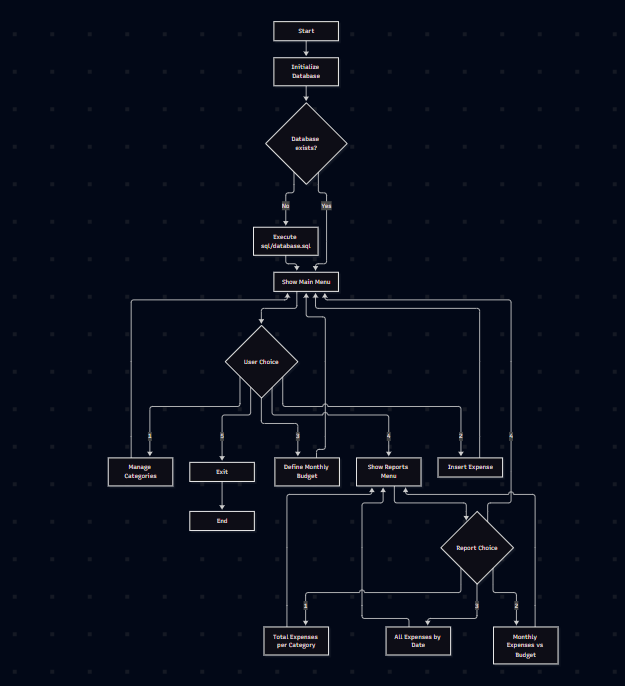

# PersonalExpenseSystem

University Programming Project for the Fundamentals of Computer Science Exam.
Console-based personal expense and budget management system built with Python and SQLite.

Features of this application include:
- Daily tracking of expenditure
- Grouping of expenditures into categories
- Setting of spending budgets per month
- Analysis of expenditure patterns
---

## Project Structure

```powershell
PersonalExpenseSystem/
│
├── README.md
│
├── sql/
│     └── database.sql
│
└── src/
       └── main.py
```

## Requirements

- **[Python 3.10](https://www.python.org/downloads/release/python-3100/) or higher**
- **SQLite 3**

## How to Run

1. Clone the repository using Git

```powershell
git clone https://github.com/iamkhin-dev/PersonalExpenseSystem.git
cd PersonalExpenseSystem
```
2. Run the project

```powershell
python src/main.py
```

## Logic

<p align="center">
  
</p>